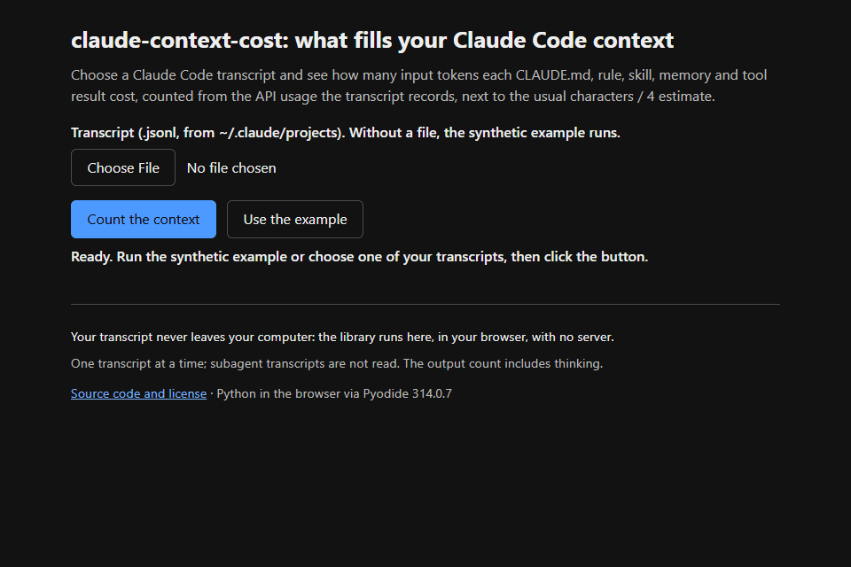

# claude-context-cost

How much each source (your `CLAUDE.md`, rules, skills, memory, tool results)
costs in the context of a Claude Code session, counted from the API `usage`
recorded in its transcript, not estimated from characters.



**[Try it in the browser](https://peterwkdev-creator.github.io/claude-context-cost/)**:
choose one of your transcripts, or run the synthetic example. The library runs
in the page (Pyodide); your file is never uploaded.

The usual estimate, characters / 4, **undercounts by 40 to 45%**: −45% over
5,365 steps of the author's sessions, mostly in Portuguese, and −40% in an
English-language session (2026-10-10). Here every response adds up to its
`usage` exactly, in all 457 transcripts tested.

> Reads only the transcripts under `~/.claude/projects` on your machine.
> Nothing is sent anywhere. The numbers are tokens, not dollars.

## Install

```bash
pip install "git+https://github.com/peterwkdev-creator/claude-context-cost@v1.3.0"
```

Python 3.11 or newer, no dependencies.

## Usage

```bash
claude-context-cost --example
```

```bash
claude-context-cost ~/.claude/projects/<project-folder>/<session-id>.jsonl
```

The newest `.jsonl` in a project's folder is its latest session (on Windows,
`~` is `%USERPROFILE%`). A subagent has its own transcript,
`<session-id>/subagents/agent-<id>.jsonl`.

Pass a project's folder instead of a file to sum its sessions and their
subagents: the costliest sources first, then one line per session. Pass
`~/.claude/projects` itself to sum every project. Tools and your own
`~/.claude/...` files add up across projects; a project's `CLAUDE.md` and
rules stay apart, marked with the project.

`--steps` shows what entered before each response, `--all` lists every
source, `--json` is for scripts (for a folder too). On the synthetic example
shipped with the package:

```text
        cost  share   entered    in    chars/4  error  how                  source
     128,240  80.6%    36,640     7          -      -  -                    unattributed: system prompt, tools, overhead
      10,400   6.5%     3,200     4      2,000   -38%  measured, split      tool: Read
       5,600   3.5%     1,600     7      1,000   -38%  estimated            claude.md: CLAUDE.md
       1,600   1.0%       800     4        500   -38%  split, estimated     path rule: .claude/rules/python.md
```

- **cost**: tokens × the responses the source stayed in context, until a
  compaction removed it. This is what you pay for over the session.
- **entered**: the tokens it brought in; **in**: the responses it stayed for.
- **chars/4** and **error**: what the usual estimate would say, beside it.

From Python:

```python
from claude_context_cost import analyze, example_path

report = analyze(example_path())  # or the path of any .jsonl transcript
print(report.total)  # 159160: input tokens summed over the 7 responses
read = report.sources[("tool", "Read")]
print(read.entered, read.responses, read.cost)  # 3200 4 10400
print(read.estimate_div4)  # 2000.0: characters / 4 for the same text
```

`summarize(folder)` returns the same sum as a folder on the command line:
`.sources` maps `(kind, name, project)` to the totals, with `project` set only
for a project's own files.

## Why

[claude-devtools](https://github.com/matt1398/claude-devtools) already shows
the context by source. Read in its code at commit `1486f20` (the latest on
2026-10-10):

- Each source's tokens are characters / 4 (`src/main/utils/tokenizer.ts`);
  only the turn total comes from the `usage`.
- Rules in `.claude/rules/` are listed as global sources without reading
  their `paths:`, so a rule that never loaded still counts. Issue
  [#224](https://github.com/matt1398/claude-devtools/issues/224), open since
  2026-07-17.
- `CLAUDE.md` and rules are read from disk today, not as they were during the
  session.

This tool fixes the first two from the transcript alone.

## What it counts

- **One response per `message.id`.** A response is written over several
  lines with the same `usage`; it counts once.
- **Context = `input_tokens` + `cache_read_input_tokens` +
  `cache_creation_input_tokens`.**
- **What entered** between two responses is the context growth minus the
  previous response's output. When a single source entered, its tokens are
  **measured**. When several did, the growth is **split** by their size.
- **At the start of the session and after each compaction** the context
  jumps at once: each source is **estimated** with the bytes-per-token ratio
  measured in the same transcript (median of its text-only steps; 2.25 when
  it has fewer than 3), and the rest is **unattributed** (system prompt,
  tool definitions). So every response adds up to its `usage`.
- **Rules with `paths:`** count only from the response where Claude Code
  loaded them (`nested_memory`), never before.
- **Only what Claude Code rendered** into the context counts; bookkeeping
  lines in the transcript do not.
- **A compaction** removes everything; messages it keeps count as "kept by
  compaction", not as new responses.

## How it is tested

- A synthetic transcript with known values (`tests/fixtures/build_example.py`)
  where every source's tokens are worked out by hand: each one comes out
  exact, every response adds up to its `usage`, a `paths:` rule that never
  loaded counts 0, a response written over several lines counts once.
- `python tests/mutate.py` breaks each of those rules in a copy of the code
  (17 mutants); the tests catch all 17.
- On the author's machine (2026-10-10): 75 session transcripts and 382
  subagent transcripts, 91,347 responses, 0 where the sources differ from the
  `usage`, 0 where the response count differs from an independent count, and
  the sum over every project takes every transcript. The
  ratio was measured in 50 of the 73 sessions with responses, median 2.22
  bytes per token. Run it on yours with
  `CLAUDE_CONTEXT_COST_CORPUS=1 python -m unittest tests.test_corpus -v`
  (it prints only counts).

## Limits

- **Split and estimated tokens are not measured.** The `how` column says
  which is which. Many steps bring a tool result together with a small
  reminder, so splitting is common.
- **Output includes thinking.** Thinking may leave the context later, so
  the previous output can be overcounted; the remainder then shows as
  negative unattributed tokens (191 of 91,347 responses).
- **A session's total does not include its subagents**; the sum of its
  project's folder does.
- **English was measured in one session** (2026-10-10): 8 file reads, a
  license, release notes, two READMEs, three Python modules and a git log;
  median −40%, from −29% to −47%. The other numbers come from one person's
  sessions, mostly in Portuguese.
- The transcript format is not documented and changes between versions.

## Compatibility

Transcripts of Claude Code 2.1 (the synthetic fixture follows 2.1.293).
Python 3.11 to 3.14, tested on Linux and Windows.

Versions follow [Semantic Versioning](https://semver.org/): the names in
`claude_context_cost.__all__` and the keys of `--json` change incompatibly only
in a new major version. The transcript format is Claude Code's and changes
without notice; when it does, a fix keeps the API and ships as a minor or
patch version.

## Contributing

See [CONTRIBUTING.md](CONTRIBUTING.md). Never paste a real transcript in an
issue or pull request: it holds paths, file contents and sometimes secrets.

## License

[MIT](LICENSE)
